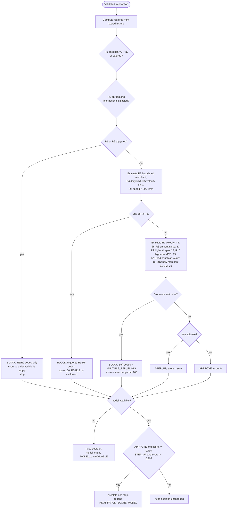
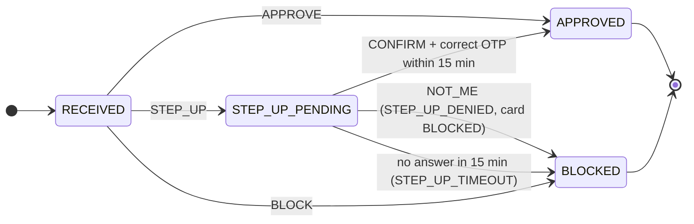
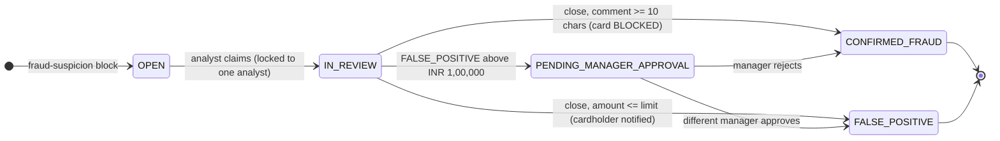
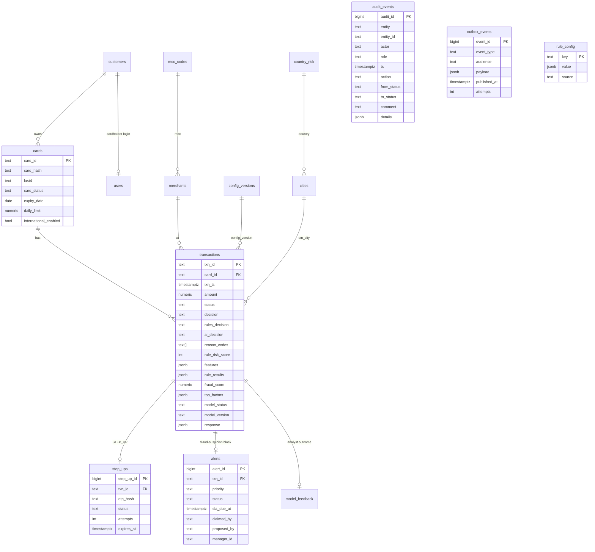
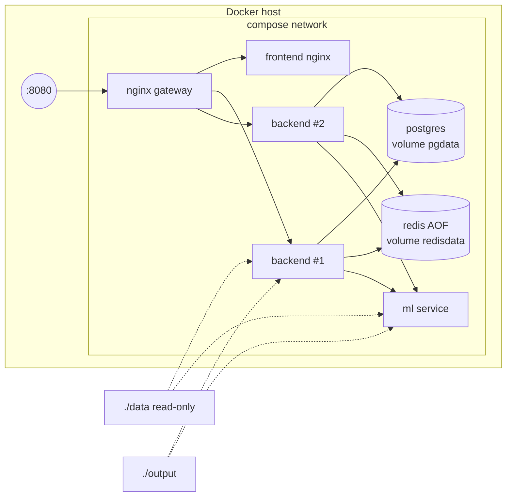

# FraudShield: High-Level Design

Real-time card transaction fraud detection, step-up verification and alert management for Kaveri National Bank
(hackathon use case 01). This document describes the system as implemented in this repository.

| | |
|---|---|
| Source of requirements | `case_01_FraudShield_V1.0.docx` (case study). Where this document and the case study differ, the case study wins. |
| Architecture guidance | `FraudShield_System_Design_and_Implementation_Plan.docx` (team design spec) |
| Status | Implemented and tested locally; see `IMPLEMENTATION_PLAN.md` for verification status and open items |

## 1. Goals and constraints


| Goal | How the design meets it |
|---|---|
| Decide every transaction in real time with explainable reasons | Synchronous authorisation API; deterministic rules R1-R13 with reason codes; per-rule evaluation detail stored with the decision |
| p95 under 300 ms including the model, 150 ms rules-only | Model loaded in memory, 150 ms model budget with rules-only fallback, one short PostgreSQL transaction per request, reference data cached in memory |
| Ask the cardholder when in doubt | STEP_UP creates a step-up request with a simulated OTP; CONFIRM / NOT_ME / timeout lifecycle |
| Prioritised analyst queue, alert visible within 5 seconds | Alerts only for fraud-suspicion codes; ordered by priority then SLA; transactional outbox, Redis Streams and Socket.IO push |
| Maker-checker and full auditability | Server-side role checks, conditional updates with row locks, append-only audit table enforced by a database trigger |
| Configurable without a release | All thresholds, windows, points, lists, SLAs and AI thresholds in the `rule_config` table, versioned and audited |
| Learned fraud score that only tightens decisions | XGBoost served by Flask; AI-2 policy can escalate APPROVE to STEP_UP and STEP_UP to BLOCK, never relax |

Out of scope (case study 6.7): real card network / ISO 8583, real OTP/SMS/e-mail, chargebacks, unblocking and re-issue,
acquiring side, mobile app.

## 2. System context

```mermaid
flowchart LR
  GW[Simulated card gateway<br/>replay script / perf script] -- "X-API-Key" --> NGINX
  U[Analyst / Manager / Cardholder<br/>browser] -- "HTTPS + JWT, WebSocket" --> NGINX
  NGINX[Nginx gateway<br/>reverse proxy + load balancer] --> FE[React frontend<br/>static files]
  NGINX --> API1[Node.js API replica 1]
  NGINX --> API2[Node.js API replica 2]
  API1 & API2 -- "SQL" --> PG[(PostgreSQL<br/>source of truth)]
  API1 & API2 -- "XADD / XREADGROUP" --> RS[(Redis Streams<br/>event log)]
  API1 & API2 -- "HTTP /predict, 150 ms budget" --> ML[Flask model service<br/>XGBoost + TreeSHAP]
  DATA[[data/ case-study files]] -. seed / reset .-> PG
  DATA -. train.py .-> ML
```

## 3. Components

| Component | Technology | Responsibility |
|---|---|---|
| Gateway | Nginx 1.27 | Single public entry point (port 8080). Routes `/api/*` and `/socket.io/*` round robin to the backend replicas, everything else to the frontend. Retries an idempotent failure on the next replica. |
| Frontend | React 18, Tailwind CSS, Vite | Operations console with role-based screens (dashboard, transactions, alert queue and investigation, approvals, audit, rule configuration, model, test runner, cardholder verification) and a standalone transaction simulator at `/simulator` that plays the card network. REST for commands, Socket.IO for notifications. |
| API (backend) | Node.js 22, Express 5 | Authentication (JWT for people, API key for the gateway), validation, authorisation service, rules engine, step-up, alerts, maker-checker, audit, dashboard, configuration, batch/replay/perf CLIs, Swagger UI. Stateless; runs as 2 replicas. |
| Model service | Python 3.13, Flask, gunicorn, XGBoost | Loads the trained model once per worker; `/predict` returns `fraud_score`, top 3 SHAP factors in plain language, model version, latency. `train.py` trains and evaluates offline. |
| PostgreSQL 16 | Relational store | Authoritative state: cards, merchants, transactions with features and rule results, step-ups, alerts, configuration and versions, audit, outbox, notifications, model feedback. |
| Redis 7 | Redis Streams | Durable event log (`fraudshield:events`) between the outbox publisher and the Socket.IO consumers. Never used for decisions or velocity counts. |

### Backend module map

```
backend/src
  engine/      pure functions: features.js (velocity, averages, speed, model features), rules.js (R1-R13),
               decision.js (AI-2 policy, alert policy, priority, SLA), geo.js (haversine), time.js (IST)
  services/    authorise.js (orchestration), stepUps.js, alerts.js, cards.js, audit.js, ruleConfig.js,
               modelClient.js, scenarios.js
  events/      outbox.js (insert in the same DB transaction), publisher.js (outbox -> Redis Stream),
               consumer.js (stream -> sockets, per-replica consumer group), socket.js (Socket.IO rooms)
  routes/      authorisations (gateway), auth, simulator, staff (transactions, alerts, dashboard, audit),
               me (cardholder), admin (config, model, demo, test runner, system)
  db/          schema.sql (idempotent migration), seed.js (data pack loader, reset)
  cli/         seed, batch (FR-10 outputs), replay, perf, run-tests
```

The engine has no I/O, so the same code serves the live API, the batch command and the unit tests.

## 4. Authorisation flow

```mermaid
sequenceDiagram
  participant G as Gateway / Simulator
  participant A as API replica
  participant P as PostgreSQL
  participant M as Model service
  participant R as Redis Stream
  G->>A: POST /api/v1/authorisations (X-API-Key)
  A->>A: authenticate, validate every field (400/401/422)
  A->>P: BEGIN; SELECT card FOR UPDATE (serialises the card)
  A->>P: txn_id exists? -> return stored response (idempotent) or 409
  A->>P: load config + prior transactions of the card (last 90 days)
  A->>A: features -> rules R1..R13 -> rule decision
  A->>M: POST /predict (features only, 150 ms timeout)
  M-->>A: fraud_score, top factors (or timeout -> MODEL_UNAVAILABLE)
  A->>A: AI-2 policy (only tightens), status, alert policy
  A->>P: INSERT transaction (+ step-up + alert) + audit + outbox; COMMIT
  A-->>G: decision JSON (reason codes, scores, status, alert_id)
  A->>R: publisher copies outbox rows to the stream (after commit)
  R-->>A: every replica's consumer group receives the event
  A-->>Browser: Socket.IO "event" to the staff room / the customer's room
```

Key properties:

- **Idempotency**: `txn_id` is the primary key. A repeat with the same canonical payload hash returns the original stored
  response and writes nothing (no second transaction, alert, audit or velocity count); a different payload returns 409.
  Concurrent duplicates are resolved by the primary key and replay the winner.
- **Concurrency**: the card row lock means two transactions of one card are evaluated one after the other, so each sees
  the other in its history and velocity cannot be bypassed by parallel requests. Different cards do not block each other.
- **Precision**: money is `NUMERIC(12,2)` in the database and summed in paise in JavaScript; distances and speeds are
  computed in double precision and rounded only for output.
- **Model budget**: the model call holds the card lock for at most `model_timeout_ms` (150 ms). On timeout or error the
  rules-only decision is returned with `model_status = MODEL_UNAVAILABLE`.

## 5. Rules engine and decision policy

Definitions follow case study 6.1 exactly: prior transactions are those of the same card with `txn_ts` strictly earlier;
`velocity_10m` counts prior transactions of any decision within the 10 minutes before; `approved_today` sums prior
APPROVED amounts on the same IST date; `avg_amount_30d` is the mean of prior APPROVED amounts in 30 days; `speed_kmph`
compares a physical transaction with the most recent prior APPROVED physical one within 6 hours (haversine, R = 6371 km);
a merchant is new when the card has no prior transaction with it in 90 days.



Alert policy (6.1.2): a BLOCKED transaction creates one alert only if a fraud-suspicion code is present
(MERCHANT_BLACKLISTED, VELOCITY_BURST, IMPOSSIBLE_TRAVEL, MULTIPLE_RED_FLAGS, STEP_UP_DENIED, STEP_UP_TIMEOUT,
HIGH_FRAUD_SCORE_MODEL). Policy declines (CARD_NOT_ACTIVE, INTL_NOT_ENABLED, DAILY_LIMIT_EXCEEDED only) create none.
Priority is HIGH for amount of INR 50,000 or more, IMPOSSIBLE_TRAVEL / MULTIPLE_RED_FLAGS / STEP_UP_DENIED, or a fraud
score of 0.90 or more; otherwise MEDIUM. `sla_due_at` = creation + 30 min (HIGH) or 240 min (MEDIUM); in batch mode the
creation time is `txn_ts`.

## 6. Status lifecycles





Step-up details: the OTP is six random digits, stored only as a SHA-256 hash, written to the application log
(`SIMULATED OTP`) and to the cardholder's simulated message inbox. A scheduled job (every 5 s, `FOR UPDATE SKIP LOCKED`, safe
on several replicas) expires pending step-ups. Wrong OTPs are counted; after `otp_max_attempts` (3) the request can no
longer be confirmed and expires.

Concurrency on alerts: claim is a conditional `UPDATE ... WHERE status = 'OPEN'`; close and manager decisions lock the row
(`SELECT ... FOR UPDATE`) and check the status. The losing request receives HTTP 409. Maker-checker compares the manager
with the stored `proposed_by` and returns 403 when they match.

## 7. Data model



- `audit_events` has a trigger that rejects every UPDATE and DELETE (FR-8). Only a demo reset (TRUNCATE) clears it.
- Full card numbers are never stored: only a salted SHA-256 hash and the last 4 digits. Screens and exports show
  `XXXXXXXXXXXX1234`.
- Each decision stores the configuration version, the model version and the exact model features used (governance).

## 8. Events and real-time updates

Choice: **Socket.IO over WebSockets** for server-to-client notifications, **REST** for every command. The browser uses the
WebSocket transport only, so the load balancer needs no sticky sessions.

1. A state change and its outbox row are written in the same PostgreSQL transaction: an event exists if and only if the
   change committed (no event for a rolled-back change, no lost event for a committed one).
2. After commit the publisher is nudged immediately (and also polls every 500 ms). It claims rows with
   `FOR UPDATE SKIP LOCKED`, `XADD`s them to `fraudshield:events` (capped at about 10,000 entries) and marks them
   published. If Redis is down the rows stay unpublished with `attempts` and `last_error`, and are retried; the
   authorisation path never touches Redis.
3. Every backend replica reads the stream with its own consumer group (`ws-<instance>`), so each replica receives every
   event and notifies its own sockets. Entries are acknowledged after handling; unacknowledged entries are re-read after a
   restart; duplicate `event_id`s are skipped (also in the browser).
4. Rooms: staff join `staff`; a cardholder joins only `customer:<own id>`. Payloads contain ids, statuses and the last 4
   digits, never card numbers or OTPs.
5. On every (re)connect the browser refreshes its view through REST, so missed events are recovered from PostgreSQL.

Measured: an alert raised on replica B reached a dashboard socket connected to replica A in about 100 ms (local run; the
requirement is 5 s).

## 9. Machine learning

| Aspect | Implementation |
|---|---|
| Data | `case_01_labelled_transactions_V1.0.csv`, schema validated on load |
| Split | Out-of-time: train `txn_ts` < 2026-01-01 (IST), test on later rows; seed 42. The latest 20% of the training period is a validation slice for early stopping, the imbalance setting and the cost threshold, so the test set is never used for a choice. |
| Features | amount, local_hour, is_international, country_risk_high, distance_from_home_km, velocity_10m, velocity_24h, amount_to_avg30_ratio, new_merchant_flag, card_age_days, card_type, channel, mcc, mcc_category, merchant_risk. Not used: txn_id, txn_ts, city_tier, any customer data. |
| Parity | `ml/fraudml/features.py` is shared by training and serving; the backend computes the same features from stored history at decision time (`engine/features.js`). |
| Imbalance | `scale_pos_weight` chosen among 1, sqrt(neg/pos) and neg/pos by validation PR-AUC |
| Model | XGBoost (depth 4, learning rate 0.05, early stopping) saved as `ml/artifacts/model.json` + `metadata.json` |
| Explanations | Exact TreeSHAP contributions (`pred_contribs`), top 3 positive factors rendered in plain language |
| Evaluation | PR-AUC (primary), ROC-AUC, precision / recall / confusion matrix at 0.70, 0.90 and the cost-optimal threshold, rules-only baseline (AI-1 definition), Isolation Forest as second detector (AI-4), expected cost (missed fraud = amount, false alarm = INR 150), friction by city_tier and card_type (AI-3), inference latency |
| Outputs | `ml/evaluation_report.md`, `output/evaluation_report.md`, `ml/model_card.md`, rules-missed fraud examples |
| Serving | gunicorn, 2 workers x 8 threads; the container retrains from scratch on every start, then loads the model once per worker. The saved booster is cut at the early-stopping iteration, so the served model is exactly the evaluated one. |
| Results (official file, test period) | XGBoost PR-AUC 0.663 vs baseline 0.133 (5.0x), ROC-AUC 0.929; at 0.70: precision 0.94, recall 0.32; Isolation Forest ROC-AUC 0.880; segment friction ratios 0.83 (city_tier and card_type); 10 labelled frauds approved by the rules but scored >= 0.70 by the model. The cost analysis favours a much lower step-up threshold (0.07); the case-study thresholds 0.70 / 0.90 are kept as configuration and the trade-off is documented in the model card. |

## 10. Security

- Gateway API key from an environment variable, compared in constant time; it never reaches the browser. The standalone
  simulator calls a separate endpoint that runs the same authorisation service; in `DEMO_MODE` it needs no login (it plays
  the card network for the demo), otherwise it requires an analyst or manager token.
- JWT bearer tokens for people; the role comes from the database row at login, never from the client. Every route checks
  the role on the server; cardholder routes filter by the `customer_id` inside the token, so changing an id in the URL
  returns 404.
- Merchant names are untrusted text: parsed with a real CSV parser, stored as data, rendered as text by React.
- Secrets come from `.env` (template `.env.example`); demo credentials exist only when `DEMO_MODE=true`.

## 11. Deployment



- Only the gateway publishes a port. Health checks: Postgres (`pg_isready`), Redis (`ping`), backend (`/health`), model
  (`/health`, model loaded), gateway (`/health`).
- Start-up: backends wait for healthy Postgres and Redis, then migrate and seed under a PostgreSQL advisory lock (so two
  replicas never seed twice). The gateway starts after the backends are healthy, so Nginx resolves every replica.
- The model container trains from scratch on every start (about 30-60 s) and only then becomes healthy; the backends wait
  for it (`depends_on: service_healthy`), so the first transaction is scored by the freshly trained model.
- Scaling path: `BACKEND_REPLICAS=n docker compose up -d` and `docker compose restart gateway` (Nginx resolves the
  replicas when it starts). Stateless replicas, per-replica consumer groups and `SKIP LOCKED` workers already support it.

## 12. Architecture decisions

| Decision | Why | Alternative not chosen |
|---|---|---|
| PostgreSQL as the only source of truth | Constraints, row locks, transactions, durable audit | Redis counters for velocity: risk of loss and races |
| Synchronous decision, asynchronous notifications | Gateway needs the decision in the response; notifications must not add latency | Queue-first authorisation: more failure modes and latency |
| Card row lock for concurrency | Simple, correct, only serialises one card | Optimistic retries: harder to reason about under bursts |
| Transactional outbox + Redis Streams | No lost or phantom events; replayable; consumer groups and ACKs | Redis Pub/Sub: fire and forget, loses events while disconnected |
| Per-replica consumer groups | Every replica can notify its own sockets without a Socket.IO adapter | Shared group: each event would reach only one replica's sockets |
| Socket.IO (WebSocket only) | Rooms, reconnection, auth handshake; no sticky sessions needed | SSE: adequate one-way, but implementing both adds cost |
| Pure rules/feature engine | Same code for API, batch and tests; easy to explain and change | Rules embedded in SQL or a rules engine product |
| XGBoost + TreeSHAP | Strong on tabular data, exact fast explanations, small artifact | LogisticRegression (team spec fallback): simpler but weaker; LLM scoring: slow and unreproducible |
| Model can only tighten | Case study guardrail; rules stay the safety floor | Model-only decisions |
| JWT in sessionStorage | Each browser tab can be a different demo user (analyst and cardholder side by side) | Cookies: shared across tabs |

## 13. Assumptions

See `IMPLEMENTATION_PLAN.md` section "Assumptions and interpretations" for the full list (for example: the 10-minute
velocity window includes a transaction exactly 10 minutes earlier; in batch mode the rules-only decision drives state
while the AI decision is reported in `fraud_scores_output.csv`; step-up expiry is measured from processing time).
