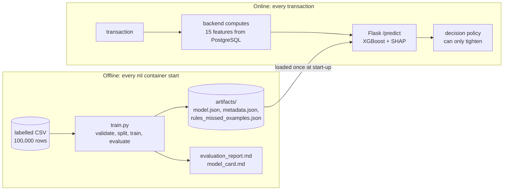
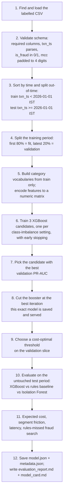
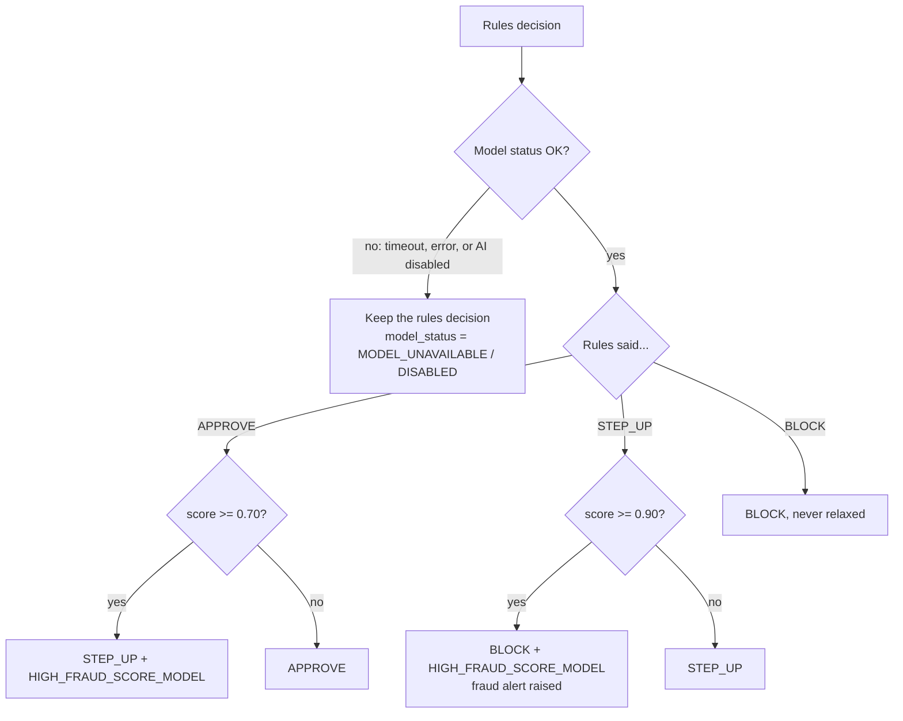
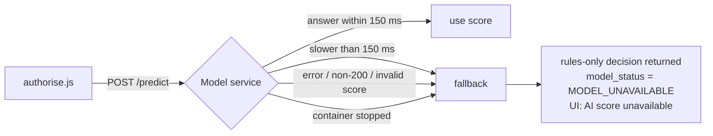

# How the FraudShield ML model works

This document walks through the machine-learning part of FraudShield end to end: how the model is trained, how it is
started, how one transaction gets scored in real time, how the score changes a decision, and what happens when the model
is not available. Every number below comes from the current training run on the official file
`data/case_01_labelled_transactions_V1.0.csv` (see `ml/evaluation_report.md`).

## 1. The big picture

There are two separate flows:

- **Offline (training):** `ml/train.py` learns from 100,000 labelled historical transactions and saves a model file.
  This runs every time the `ml` container starts.
- **Online (scoring):** for every live transaction, the backend computes the same 15 features from the database and asks
  the Flask service for a fraud score. The score can only make the rules-engine decision stricter.



The model is a **supplement** to the 13 business rules, not a replacement. The rules always run first and remain the safety floor.

## 2. Files involved

| File | Role |
|---|---|
| `ml/train.py` | Training and evaluation pipeline (one command, fixed seed) |
| `ml/fraudml/features.py` | The 15 feature definitions, encoding, validation and plain-language explanations; shared by training and serving |
| `ml/report.py` | Writes `evaluation_report.md` and `model_card.md` from the training metrics |
| `ml/app.py` | Flask service: `/health`, `/model/info`, `/predict` |
| `ml/entrypoint.sh` | Container start: train from scratch, then serve with gunicorn |
| `ml/artifacts/` | Generated model and metadata (not committed; rebuilt on every start) |
| `backend/src/engine/features.js` | Computes the same 15 features live from stored history |
| `backend/src/services/modelClient.js` | Calls `/predict` with a 150 ms budget; returns MODEL_UNAVAILABLE on failure |
| `backend/src/engine/decision.js` | AI-2 decision policy (`applyModelScore`) |
| `backend/src/services/authorise.js` | Orchestrates rules, model call, decision and persistence |

## 3. Start-up flow

```mermaid
sequenceDiagram
  participant DC as docker compose up
  participant ML as ml container
  participant BE as backend replicas
  participant GW as nginx gateway
  DC->>ML: start
  ML->>ML: python train.py (from scratch, about 30-60 s)
  ML->>ML: write artifacts + reports
  ML->>ML: gunicorn starts; each worker loads model.json once
  ML-->>DC: /health = UP (model_loaded true)
  DC->>BE: start (depends_on ml: service_healthy)
  BE-->>DC: /health ok
  DC->>GW: start
  Note over BE,ML: the first live transaction is already scored by the freshly trained model
```

- Training is deterministic (seed 42): the same CSV always gives a byte-identical `model.json`. Only the version label's
  timestamp changes.
- To retrain on demand: `docker compose restart ml`.

## 4. Training pipeline (`ml/train.py`)



### 4.1 Why an out-of-time split

Fraud patterns change over time, and in production the model always scores the future. So the split is by date, not
random:

```
2025-09-01 ......................................... 2026-01-01 ................. 2026-02-28
|<------------- training period (67,085 rows) ------------->|<-- test (32,915 rows) -->|
|<------- fit (53,668) ------->|<-- validation (13,417) -->|
```

- **Fit:** the rows the trees learn from.
- **Validation:** the latest 20% of the training period. It is used for early stopping, choosing the imbalance setting and
  choosing the cost-optimal threshold.
- **Test:** never used for any choice. All reported metrics come from it.
- Fraud rate: 1.23% in training, 1.30% in test, so roughly 1 fraud in every 80 transactions.

### 4.2 Features (exactly the case-study list)

The model uses the same 15 features at training time and in live scoring. In the labelled file they are pre-computed; in
live scoring the backend computes them from the database with the same definitions (case study 6.1.2).

| Feature | Meaning | Live computation (`features.js`) | Encoding |
|---|---|---|---|
| `amount` | Transaction amount (INR) | from the request | number |
| `local_hour` | Hour of day in IST | from `txn_ts` | number 0-23 |
| `is_international` | Country differs from the card's home country | `txn_country != home_country` | 0/1 |
| `country_risk_high` | Transaction country risk is HIGH | `country_risk` table | 0/1 |
| `distance_from_home_km` | Distance from the card's home city | haversine(home city, txn city), R = 6371 km | number |
| `velocity_10m` | Prior transactions in the previous 10 minutes | count of earlier card transactions | number |
| `velocity_24h` | Prior transactions in the previous 24 hours | count of earlier card transactions | number |
| `amount_to_avg30_ratio` | Amount divided by the 30-day average approved amount | amount / avg_amount_30d, empty with no history | number or missing |
| `new_merchant_flag` | No transaction with this merchant in 90 days | history lookup | 0/1 |
| `card_age_days` | Days since the card was issued | txn date - issue_date | number |
| `card_type` | DEBIT / CREDIT | `cards` table | category |
| `channel` | POS / ECOM / ATM / CONTACTLESS | from the request | category |
| `mcc` | Merchant category code | from the request | category |
| `mcc_category` | Category group (for example QUASI_CASH) | `mcc_codes` table | category |
| `merchant_risk` | LOW / MEDIUM / HIGH / BLACKLISTED | `merchants` table | category |

**Deliberately excluded:**
- `txn_id`, `txn_ts` and `city_tier` (AI-1).
- All customer data: names, mobile numbers, e-mails.
- Card numbers, which never reach the model.

**Encoding** (`fraudml/features.py`):
- Numbers stay numbers. Yes/no values become 0/1.
- Each category becomes its position in a sorted vocabulary built from the training data.
- Unknown categories and empty values become "missing", and XGBoost learns which way to send missing values in every tree.
- The same function encodes training rows and live requests, so the model cannot see a different format in production.

### 4.3 The model

| Setting | Value | Why |
|---|---|---|
| Algorithm | XGBoost gradient-boosted decision trees | Strong on tabular data; captures interactions such as "high amount AND new merchant AND far from home" |
| Trees | up to 600, early stopping after 40 rounds without improvement | Stops before overfitting; the current model uses 204 trees (best iteration 203) |
| Depth / learning rate | max depth 4, learning rate 0.05 | Small trees, slow learning: stable and explainable |
| Sampling | 80% of rows and 80% of features per tree | Reduces overfitting |
| Seed | 42 | Reproducible results |

**Class imbalance.** Only about 1.3% of rows are fraud. Three settings of `scale_pos_weight` (how much extra weight a
fraud row gets) are tried and compared on the validation slice:

| Option | Validation PR-AUC |
|---|---|
| 1 (unweighted) | **0.6268** (chosen) |
| sqrt(neg/pos) | 0.6207 |
| neg/pos | 0.5859 |

Unweighted won, which also keeps the scores closer to real probabilities.

**Served model = evaluated model.** After choosing, the booster is cut at the early-stopping best iteration
(`model.get_booster()[: best_iteration + 1]`). That exact booster produces every metric and is the file that is saved and
served. Category C of the test suite re-scores stored examples through the live service to prove it.

### 4.4 Evaluation (test period, never seen during training)

**Ranking quality.** PR-AUC is the primary metric, because accuracy is meaningless when 98.7% of rows are genuine:

| Detector | PR-AUC | ROC-AUC |
|---|---|---|
| XGBoost | **0.6630** | 0.9293 |
| Rules-only baseline (AI-1 formula) | 0.1329 | 0.7155 |
| Isolation Forest (unsupervised second detector, AI-4) | 0.1807 | 0.8797 |

XGBoost's PR-AUC is **4.99x** the baseline (the case study's reference target is 2x).

The **baseline** is the case-study formula, computed from the same file:
- Score 100 if `velocity_10m >= 5` or the merchant is blacklisted.
- Otherwise, the sum of the rule points: R7 25, R8 30, R9 25, R10 15, R11 15, R12 20, capped at 100.

**Operating points** (precision = share of flagged transactions that really are fraud; recall = share of frauds caught):

| Operating point | Precision | Recall | Frauds caught | False alarms |
|---|---|---|---|---|
| XGBoost >= 0.70 (step-up threshold) | 0.938 | 0.319 | 136 of 427 | 9 |
| XGBoost >= 0.90 (block threshold) | 0.952 | 0.187 | 80 | 4 |
| XGBoost >= 0.07 (cost-optimal) | 0.391 | 0.745 | 318 | 495 |
| Baseline, any rule | 0.082 | 0.480 | 205 | 2,299 |

**Expected cost (AI-3).** Each missed fraud costs its amount, and each false alarm costs ₹150. The threshold with the
lowest cost on the validation slice is 0.07:

| Threshold | Missed fraud | False alarms | Total cost |
|---|---|---|---|
| 0.70 (case study) | ₹39.6 lakh | 9 | ₹39.6 lakh |
| 0.07 (cost-optimal) | ₹4.0 lakh | 495 | ₹4.7 lakh |
| Baseline rules | ₹20.3 lakh | 2,299 | ₹23.7 lakh |

The case-study thresholds (0.70 / 0.90) are kept as configuration. The cost table is evidence that a lower step-up
threshold would catch far more fraud for a small number of extra customer checks. A manager can change
`ai_step_up_threshold` on the Rules page; the change is versioned and audited.

**Fairness check (AI-3).** This measures friction on genuine customers: the share of genuine transactions the model would
step up or block at 0.70. The lowest segment's rate divided by the highest must not fall below 0.8:

| Dimension | Ratio (lowest / highest) | Result |
|---|---|---|
| city_tier (METRO vs NON_METRO) | 0.83 | pass |
| card_type (CREDIT vs DEBIT) | 0.83 | pass |

**Speed.** One prediction plus its explanation takes 0.60 ms (p50) and 0.94 ms (p95) inside the service.

**Frauds the rules miss but the model catches.** These are 10 test-period frauds where the baseline score is 0 (the rules
would approve) and the model scores 0.70 or more. Top example: `T400085854`, score 0.9765. The factors are amount
₹39,244.52, 4.7x the card's 30-day average, and the first transaction with that merchant in 90 days; no single rule
fires. The Model page lists all 10, and **Score now** re-scores them through the live service.

### 4.5 Outputs of a training run

| Output | Contents |
|---|---|
| `ml/artifacts/model.json` | The trained booster |
| `ml/artifacts/metadata.json` | Version, dataset name and SHA-256, row counts, split, seed, feature list, category vocabularies, every metric, costs, segments, latency |
| `ml/artifacts/rules_missed_examples.json` | The 10 rules-missed frauds with features, score and top factors |
| `ml/evaluation_report.md`, `output/evaluation_report.md` | Full metric tables (AI-1, AI-3, AI-4) |
| `ml/model_card.md` | Purpose, data, model, threshold rationale, segment check, limitations, governance |

The model version looks like `xgb-202610231007-64453f17`: the training time plus the first 8 characters of the model
file's hash.

## 5. Scoring one live transaction

```mermaid
sequenceDiagram
  participant C as Card gateway / simulator
  participant A as Backend (authorise.js)
  participant DB as PostgreSQL
  participant M as Flask model service
  C->>A: POST transaction
  A->>DB: lock card row; load config + last 90 days of the card's history
  A->>A: features.js: rule features + the 15 model features
  A->>A: rules.js: R1..R13 -> rule decision (APPROVE / STEP_UP / BLOCK)
  A->>M: POST /predict {features} (timeout 150 ms)
  M->>M: validate -> encode -> booster.predict -> SHAP contributions
  M-->>A: fraud_score, top_factors, model_version, latency_ms
  A->>A: decision.js: apply AI-2 policy (only tightens)
  A->>DB: store decision, features, score, factors, model_version, model_status
  A-->>C: decision JSON
```

**Inside `/predict`** (`ml/app.py`):
1. Check the body is JSON with a `features` object (400 otherwise).
2. Validate each feature (`validate_features`). Required fields must be present, numbers must be non-negative, flags must
   be 0/1, and `local_hour` must be 0-23. Errors return 422 with field names.
3. Encode the features with the same function family used in training (`encode_one`).
4. `booster.predict` gives the fraud probability, `fraud_score`, between 0 and 1.
5. `booster.predict(pred_contribs=True)` gives the exact TreeSHAP contribution of every feature.
6. Take the 3 largest contributions and turn them into plain language (`describe`).
7. Return the score, factors, model version and latency. Only the latency is logged; no card data reaches this service.

Real response from the current model for worked example 10: a ₹45,000 crypto purchase (MCC 6051) at 02:00 IST, at a
merchant new to the card, 18.75x the 30-day average:

```json
{ "fraud_score": 0.992439, "model_status": "OK", "model_version": "xgb-202610231007-64453f17", "latency_ms": 2.5,
  "top_factors": [
    { "feature": "amount_to_avg30_ratio", "value": 18.75, "contribution": 2.8832, "direction": "raises", "text": "amount 18.8x the card's 30-day average" },
    { "feature": "new_merchant_flag", "value": 1.0, "contribution": 2.1447, "direction": "raises", "text": "first transaction with this merchant in 90 days" },
    { "feature": "amount", "value": 45000.0, "contribution": 2.0577, "direction": "raises", "text": "amount INR 45,000.00" } ] }
```

The contributions are in log-odds units: positive values push the score up, negative ones push it down. Here the rules
already BLOCK this transaction (MULTIPLE_RED_FLAGS), so the score adds explanation but cannot change the decision.

## 6. How the score changes the decision (AI-2)



Key rules of the policy:
- **The model never relaxes a decision.** A rules BLOCK stays BLOCK even at score 0.00.
- **At most one step stricter.** APPROVE with a score of 0.99 becomes STEP_UP (ask the cardholder), not BLOCK. Uncertain
  cases go to the customer, not straight to a decline.
- **The model's influence is visible.** Every escalation adds the reason code `HIGH_FRAUD_SCORE_MODEL`, after the rule
  codes.
- **Thresholds are configuration.** Both come from `case_01_rules_config_V1.0.json` (`ai_step_up_threshold` 0.70,
  `ai_block_threshold` 0.90).
- **The score sets alert priority.** A score of 0.90 or more makes an alert HIGH priority (30-minute SLA).
- **Rules-only is always recorded.** `rules_decision` is stored next to the final decision, so the model's effect is
  always auditable.

Case-study checks (both automated in test category C):

| Example | Rules say | Score | Final decision |
|---|---|---|---|
| 13: worked example 1 | APPROVE | 0.82 | STEP_UP, `HIGH_FRAUD_SCORE_MODEL` |
| 14: worked example 9 | STEP_UP (HIGH_VELOCITY) | 0.93 | BLOCK, `HIGH_VELOCITY\|HIGH_FRAUD_SCORE_MODEL`, HIGH alert |

In batch mode (`batch.js`), the rules-only decision drives `decisions_output.csv`. The model score and the AI-2 final
decision go to `fraud_scores_output.csv`.

## 7. When the model is not available



- The authorisation itself never fails because of the model.
- The 150 ms budget is `model_timeout_ms` in the rule configuration.
- A manager can switch the model off with `ai_enabled = false`, which records `model_status = DISABLED`.
- To demonstrate the fallback: `docker compose stop ml`, then send a transaction.

## 8. Where the model is visible in the UI

| Screen | What you see |
|---|---|
| Simulator (`/simulator`) | Fraud score, model status, model latency; **Details** shows the top 3 factors and the feature values |
| Transaction detail | Score, model status, rules-only decision, model version, top 3 SHAP factors in plain language |
| Alert investigation | The same panel next to the triggered rules and feature values, so analysts see why the model is worried |
| Fraud dashboard | Model status counts and how many decisions the model tightened |
| Model page | Metrics, operating points, segment table, the 10 rules-missed frauds with **Score now** |
| Cardholder screens | Nothing from the model, only a neutral message (case-study guardrail) |

## 9. Responsible-AI guardrails and how they are met

| Guardrail (case study 6.2.1) | Implementation |
|---|---|
| Human oversight | The model only tightens. Confirming fraud and releasing false positives are analyst and manager decisions, with maker-checker above ₹1,00,000 |
| Explainability | `HIGH_FRAUD_SCORE_MODEL` on every AI-influenced decision, plus the top 3 TreeSHAP factors in plain language |
| Uncertain output | APPROVE escalates only to STEP_UP (the customer is asked); BLOCK requires the rules to have asked for STEP_UP already |
| Fallback | 150 ms budget, MODEL_UNAVAILABLE, "AI score unavailable" in the UI |
| Privacy | Only features reach the model; no card numbers, names or mobile numbers |
| Fairness | No demographic features; friction compared by city_tier and card_type (ratios 0.83) |
| Governance | Every decision stores `model_version` and the exact features used. Training is one command with a fixed seed. Analysts' outcomes are saved in `model_feedback` as labels for the next training run |

## 10. Verifying it yourself

```bash
docker compose logs ml | head -20                      # training output: candidates, PR-AUC, version
docker compose exec ml python -m pytest -q tests       # feature parity, baseline formula, Flask endpoints
docker compose exec backend node src/cli/run-tests.js C   # 15 model tests: real service + decision policy + fallback
curl -s http://localhost:8080/api/v1/model/info -H "Authorization: Bearer <staff token>"   # metrics (or the Model page)
```

## 11. Where to change things

| Change | Where |
|---|---|
| AI thresholds, model timeout, kill switch | Rules page (no code): `ai_step_up_threshold`, `ai_block_threshold`, `model_timeout_ms`, `ai_enabled` |
| Model settings (depth, trees, learning rate) | `fit()` in `ml/train.py`, then `docker compose restart ml` |
| Add or change a feature | `ml/fraudml/features.py` (`NUMERIC` / `CATEGORICAL` and `describe`) **and** the matching live computation in `backend/src/engine/features.js` |
| Plain-language wording of factors | `describe()` in `ml/fraudml/features.py` |
| Escalation policy | `applyModelScore()` in `backend/src/engine/decision.js` |
| Report and model-card text | `ml/report.py` |
