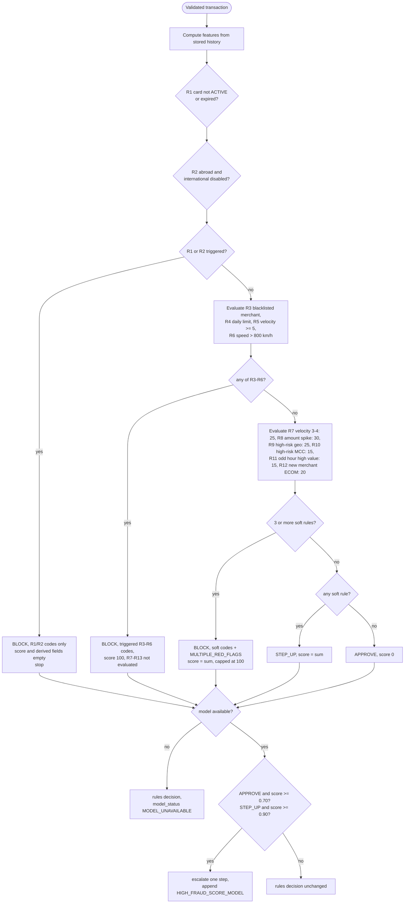
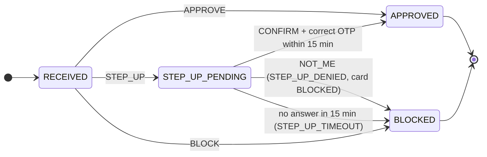
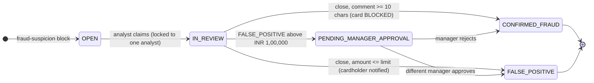
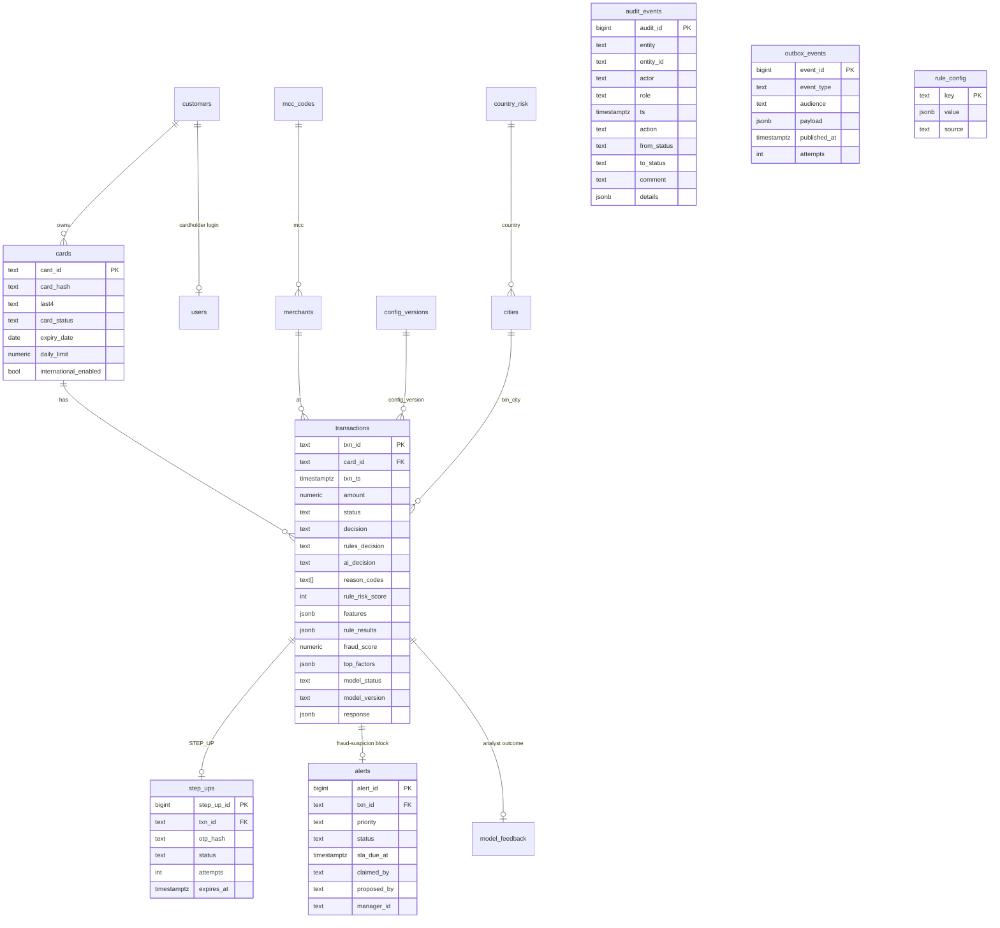

# FraudShield design document

Deliverable for case study section 6.6 (`/output/design`). Generated from [HLD.md](../../HLD.md); edit HLD.md and regenerate with `python3 scripts/build_design_doc.py`.

## Decision flowchart (R1 to R13 evaluation order)

Definitions follow case study 6.1 exactly: prior transactions are those of the same card with `txn_ts` strictly earlier;
`velocity_10m` counts prior transactions of any decision within the 10 minutes before; `approved_today` sums prior
APPROVED amounts on the same IST date; `avg_amount_30d` is the mean of prior APPROVED amounts in 30 days; `speed_kmph`
compares a physical transaction with the most recent prior APPROVED physical one within 6 hours (haversine, R = 6371 km);
a merchant is new when the card has no prior transaction with it in 90 days.



Alert policy (6.1.2): a BLOCKED transaction creates one alert only if a fraud-suspicion code is present
(MERCHANT_BLACKLISTED, VELOCITY_BURST, IMPOSSIBLE_TRAVEL, MULTIPLE_RED_FLAGS, STEP_UP_DENIED, STEP_UP_TIMEOUT,
HIGH_FRAUD_SCORE_MODEL). Policy declines (CARD_NOT_ACTIVE, INTL_NOT_ENABLED, DAILY_LIMIT_EXCEEDED only) create none.
Priority is HIGH for amount of INR 50,000 or more, IMPOSSIBLE_TRAVEL / MULTIPLE_RED_FLAGS / STEP_UP_DENIED, or a fraud
score of 0.90 or more; otherwise MEDIUM. `sla_due_at` = creation + 30 min (HIGH) or 240 min (MEDIUM); in batch mode the
creation time is `txn_ts`.

## Transaction and alert status lifecycles





Step-up details: the OTP is six random digits, stored only as a SHA-256 hash, written to the application log
(`SIMULATED OTP`) and to the cardholder's simulated message inbox. A scheduled job (every 5 s, `FOR UPDATE SKIP LOCKED`, safe
on several replicas) expires pending step-ups. Wrong OTPs are counted; after `otp_max_attempts` (3) the request can no
longer be confirmed and expires.

Concurrency on alerts: claim is a conditional `UPDATE ... WHERE status = 'OPEN'`; close and manager decisions lock the row
(`SELECT ... FOR UPDATE`) and check the status. The losing request receives HTTP 409. Maker-checker compares the manager
with the stored `proposed_by` and returns 403 when they match.

## ER diagram



- `audit_events` has a trigger that rejects every UPDATE and DELETE (FR-8). Only a demo reset (TRUNCATE) clears it.
- Full card numbers are never stored: only a salted SHA-256 hash and the last 4 digits. Screens and exports show
  `XXXXXXXXXXXX1234`.
- Each decision stores the configuration version, the model version and the exact model features used (governance).

## Architecture

```mermaid
flowchart LR
  GW[Simulated card gateway<br/>replay script / perf script] -- "X-API-Key" --> NGINX
  U[Analyst / Manager / Cardholder<br/>browser] -- "HTTPS + JWT, WebSocket" --> NGINX
  NGINX[Nginx gateway<br/>reverse proxy + load balancer] --> FE[React frontend<br/>static files]
  NGINX --> API1[Node.js API replica 1]
  NGINX --> API2[Node.js API replica 2]
  API1 & API2 -- "SQL" --> PG[(PostgreSQL<br/>source of truth)]
  API1 & API2 -- "XADD / XREADGROUP" --> RS[(Redis Streams<br/>event log)]
  API1 & API2 -- "HTTP /predict, 150 ms budget" --> ML[Flask model service<br/>XGBoost + TreeSHAP]
  DATA[[data/ case-study files]] -. seed / reset .-> PG
  DATA -. train.py .-> ML
```

## Technology decisions

| Decision | Why | Alternative not chosen |
|---|---|---|
| PostgreSQL as the only source of truth | Constraints, row locks, transactions, durable audit | Redis counters for velocity: risk of loss and races |
| Synchronous decision, asynchronous notifications | Gateway needs the decision in the response; notifications must not add latency | Queue-first authorisation: more failure modes and latency |
| Card row lock for concurrency | Simple, correct, only serialises one card | Optimistic retries: harder to reason about under bursts |
| Transactional outbox + Redis Streams | No lost or phantom events; replayable; consumer groups and ACKs | Redis Pub/Sub: fire and forget, loses events while disconnected |
| Per-replica consumer groups | Every replica can notify its own sockets without a Socket.IO adapter | Shared group: each event would reach only one replica's sockets |
| Socket.IO (WebSocket only) | Rooms, reconnection, auth handshake; no sticky sessions needed | SSE: adequate one-way, but implementing both adds cost |
| Pure rules/feature engine | Same code for API, batch and tests; easy to explain and change | Rules embedded in SQL or a rules engine product |
| XGBoost + TreeSHAP | Strong on tabular data, exact fast explanations, small artifact | LogisticRegression (team spec fallback): simpler but weaker; LLM scoring: slow and unreproducible |
| Model can only tighten | Case study guardrail; rules stay the safety floor | Model-only decisions |
| JWT in sessionStorage | Each browser tab can be a different demo user (analyst and cardholder side by side) | Cookies: shared across tabs |

## API documentation

OpenAPI 3: `GET /api/openapi.json`, Swagger UI at `/api/docs` (source `backend/src/openapi.js`). Summary: [docs/API.md](../../docs/API.md).

## Assumptions

See [IMPLEMENTATION_PLAN.md](../../IMPLEMENTATION_PLAN.md#assumptions-and-interpretations).
